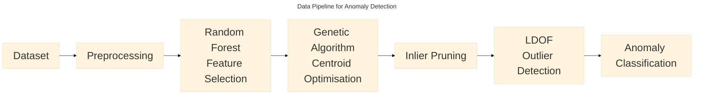

## Revisiting my Master's Research Project

It has been about a year and a half since I clicked submit on the report that would cap my master's degree. I had worked hard on it and while the technical accomplishment was not particularly impressive, I had stuck to my academic goals of clarifying and validating (or invalidating) some previous research. 

The research I had based my project on was a paper submitted for a conference [Genetic Algorithm Based Anomaly Detection for Intrusion Detection](https://link.springer.com/chapter/10.1007/978-3-031-47224-4_17)  from the AMRIT conference in Silchar, India. While I do not wish to speak negatively about the researchers or the research itself, it contained some repeating patterns in the data that I couldn't explain, and they didn't attempt to in the paper. In particular, precision and recall for each experiment were reportedly identical (giving identical F1 scores, too).

### Nitpicking

That set off some alarm bells almost immediately. In terms of true positive (TP) and false positive (FP) we say that:

$$
Precision = \frac{TP}{TP+FP}
$$

and:

$$
Recall = \frac{TP}{TP+FN}
$$

Therefore:

$$
\frac{TP}{TP+FP}=\frac{TP}{TP+FN}
$$

Assuming $TP \neq 0$ :

$$
TP+FP=TP+FN
$$

So, if precision and recall are identical, then:

$$
FP = FN
$$

Of course, there's a caveat here. The results are reported to three decimal places, so precision and recall might not actually be identical in the underlying calculation. However, seeing this pattern repeat across different experimental configurations was enough to make me curious.

Furthermore, the results were not very encouraging. I was surprised that the results were so poor, particularly given that the paper presented the approach as a *promising anomaly detection methodology*. Anyway, the paper wasn't very long and immediately, I found a few points that I would like more clarification on. The first was the exact methodology chosen. There were some clear omissions, like how exactly inliers to be pruned were defined, making a direct validation of the results impossible without further clarification. I tried emailing the lead author of the paper but got no reply. I also noticed that the dataset used in the experiment was really small, just a few thousand records. While this likely enabled the experiment to work on modest hardware, I questioned how generalisable and potentially effective this methodology could be when scaled to larger systems.

### Validation

To validate the results, I reconstructed the anomaly detection pipeline as best I could, following what details were given about the implementation and making informed decisions based on research when necessary.

Let's first outline the anomaly detection pipeline: The dataset is first cleaned and normalised, feature selection is performed by a random forest classifier and then genetic algorithms find cluster centroids within the multi-dimensional data by evaluating their fit using the [Davies Bouldin Index](https://dl.acm.org/doi/10.1109/TPAMI.1979.4766909). Those centroids are used to prune inliers, reducing computational complexity. Outliers are then detected using a technique called [Local Distance-based Outlier Factor(LDOF).](https://arxiv.org/abs/0903.3257)

### Baroooooo!

Have you noticed the elephant in the room? Both the original paper, and my recreation, make no mention about how network data is usually ingested or monitored. That's because this dataset comes as a set of prepared csv files. What is the point of looking for a deviation from a baseline in a static snapshot of the whole network data over 5 days? An effective online anomaly detector should establish a baseline and then look for outliers from that baseline. Simply clustering all all data points and then looking for outliers is a fundamentally different proposition.

My facepalm moment lasted only so long. My goal for my master's degree was not to create the best anomaly detector that I could, it was to validate the methodology used in the paper my research was based on. I think I did that, establishing that with careful choice of hyper-parameters and number of clusters a slightly-better-than-pure-luck outcome could be achieved. I couldn't recreate the results of the conference paper as hard as I tried. My pipeline was, well, not to brag about it...better. 

I say it was better, my university gave me access to the [Viking compute cluster](https://www.york.ac.uk/it-services/tools/viking/). With 96 CPU cores per compute node and enough memory that in today's economy might buy a small country. It was pretty computationally intense.

### Onward..and Sideways

After submitting the paper, of course, I quickly implemented a sliding window over the data points and fed them into the pipeline according to the timestamps of each record. Pruning datapoints was now not necessary as the data-rate was easily processable in real time by either my M4 macbook pro or my ageing AMD Ryzen 3600 processors. The results were also much better (more accurate and precise) and while I don't think genetic algorithms are necessarily the best way to baseline network traffic, I think proving that will be work for my PhD.